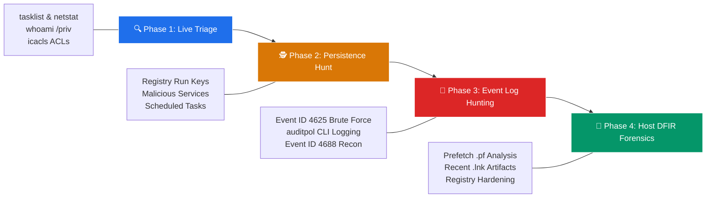

<div align="center">

# 🛡️ Windows OS Threat Hunting & DFIR Portfolio
### **SOC Analyst Tier-1 | Live Triage • Persistence Hunting • Event Log Forensics**


</div>

---

## 🗺️ SOC Investigation Workflow (Architecture)



---

## 📊 Executive Lab Matrix (MITRE ATT&CK Mapped)

| Lab | Investigation Focus | MITRE ATT&CK | Windows Event / Artifact | CLI / GUI Tools |
| :---: | :--- | :--- | :--- | :--- |
| **01** | **Process & Network Correlation** | `T1055` Process Injection | Active TCP / PIDs | `tasklist`, `netstat` |
| **02** | **Privilege & Token Enumeration** | `T1134` Token Manipulation | `SeImpersonatePrivilege` | `whoami /priv` |
| **03** | **File ACLs & Ransomware Block** | `T1486` Data Encrypted | NTFS Permissions | `icacls` |
| **04** | **Registry Run Key Persistence** | `T1547.001` Registry Run Keys | `HKCU\...\Run` | `reg add/query/delete` |
| **05** | **Malicious Service Persistence** | `T1543.003` Windows Service | Event ID `7045` / `4697` | `sc`, `services.msc` |
| **06** | **Scheduled Task Persistence** | `T1053.005` Scheduled Task | Event ID `4698` / `.xml` | `schtasks`, `taskschd.msc` |
| **07** | **Failed Logon & Lockout Policy** | `T1110` Brute Force | Event ID `4625` | `runas`, `net accounts` |
| **08** | **Brute-Force Log Hunting** | `T1110` Brute Force | Event ID `4625` (`0xC0000064`) | `Event Viewer`, `Get-WinEvent` |
| **09** | **Command-Line Auditing Setup** | `T1059` Command Execution | `ProcessCreationIncludeLine` | `auditpol`, `reg` |
| **10** | **Discovery Command Hunting** | `T1087` / `T1033` Discovery | Event ID `4688` | `Event Viewer`, `Get-WinEvent` |
| **11** | **Execution Forensics (Prefetch)** | `T1204` User Execution | `C:\Windows\Prefetch\*.pf` | `dir /o-d`, `reg` |
| **12** | **User Activity Forensics (LNK)** | `T1083` File Discovery | Recent `.lnk` Files | `dir` |

---

## 🔬 Interactive Lab Walkthroughs (Click to Expand)

> [!TIP]
> **How to use this repository:** Upload your 18 lab screenshots into a folder named `screenshots/` in this repo, and each lab section below will automatically display your proof-of-work!

<details open>
<summary><h3>🔵 Phase 1: Live System Triage & Access Control (Labs 01 – 03)</h3></summary>

#### 🔹 Lab 01: Process & Network Connection Triage
* **Commands:** `tasklist /fi "imagename eq notepad.exe"` & `netstat -ano | findstr ESTABLISHED`
* **SOC Finding:** Correlated `Notepad.exe` (PID `1040`) making outbound HTTPS (`443`) connections—a key indicator of **Process Injection**.
* **Evidence:** ``

#### 🔹 Lab 02: Privilege & Token Enumeration
* **Commands:** `whoami /user` & `whoami /priv`
* **SOC Finding:** Identified `SeImpersonatePrivilege` as **Enabled**, which adversaries abuse for `SYSTEM` privilege escalation.
* **Evidence:** ``

#### 🔹 Lab 03: File ACLs & Ransomware Containment
* **Commands:** `icacls secret.txt /inheritance:r /grant:r ELCOT:(R)` & `icacls secret.txt /reset`
* **SOC Finding:** Enforced Read-Only (`R`) NTFS ACLs to block unauthorized file modification (`Access is denied`).
* **Evidence:** ``

</details>

---

<details>
<summary><h3>🟠 Phase 2: Persistence Hunting & Remediation (Labs 04 – 06)</h3></summary>

#### 🔸 Lab 04: Registry Run Key Persistence (`T1547.001`)
* **Commands:** `reg add/query/delete HKCU\Software\Microsoft\Windows\CurrentVersion\Run /v SOC_Backdoor`
* **SOC Finding:** Simulated startup persistence and verified clean registry eradication.
* **Evidence:** ``

#### 🔸 Lab 05: Malicious Service Persistence (`T1543.003`)
* **Commands & GUI:** `sc create SOC_MalwareSvc`, `sc qc`, `sc config ... start= disabled`, `sc delete` + `services.msc`
* **SOC Finding:** Verified `LocalSystem` auto-start service across both CLI and Services GUI before disabling and deleting it.
* **Evidence:** ``

#### 🔸 Lab 06: Scheduled Task Persistence (`T1053.005`)
* **Commands & GUI:** `schtasks /create /tn "SOC_PersistTask"`, `dir C:\Windows\System32\Tasks`, `schtasks /delete` + `Task Scheduler`
* **SOC Finding:** Audited daily scheduled execution triggers in GUI and verified XML task file deletion in `System32\Tasks`.
* **Evidence:** ``

</details>

---

<details>
<summary><h3>🔴 Phase 3: Authentication Hardening & Event Log Hunting (Labs 07 – 10)</h3></summary>

#### 🔺 Lab 07 & 08: Brute-Force Simulation & Event ID 4625 Hunting
* **Commands:**
  ```powershell
  runas /user:fakehacker cmd
  net accounts /lockoutthreshold:5 /lockoutduration:30 /lockoutwindow:30
  Get-WinEvent -FilterHashtable @{LogName='Security'; ID=4625} -MaxEvents 2 | Format-List TimeCreated, Message
  ```
* **SOC Finding:** Hunted `Logon Type 2` failures (`Sub Status: 0xC0000064` - bad username) in Event Viewer and PowerShell, and enforced a 5-attempt lockout threshold.
* **Evidence:** ``

#### 🔺 Lab 09 & 10: Process Creation Auditing & Event ID 4688 Hunting
* **Commands:**
  ```powershell
  auditpol /set /subcategory:"Process Creation" /success:enable /failure:enable
  reg add "HKLM\SOFTWARE\Microsoft\Windows\CurrentVersion\Policies\System\Audit" /v ProcessCreationIncludeLine_Enabled /t REG_DWORD /d 1 /f
  Get-WinEvent -FilterHashtable @{LogName='Security'; ID=4688} -MaxEvent 30 | Where-Object {\$_.Message -match "whoami|net"}
  ```
* **SOC Finding:** Enabled full command-line auditing and hunted parent-child recon chains (`cmd.exe` -> `whoami /priv`, `net.exe` -> `net1.exe user`).
* **Evidence:** ``

</details>

---

<details>
<summary><h3>🟢 Phase 4: Host-Based Digital Forensics / DFIR (Labs 11 – 12)</h3></summary>

#### ✅ Lab 11: Windows Prefetch Execution Forensics (`T1204`)
* **Commands:** `dir C:\Windows\Prefetch\*.pf /o-d` & `reg add "...\PrefetchParameters" /v EnablePrefetcher /t REG_DWORD /d 3 /f`
* **SOC Finding:** Verified historical execution timestamps via `.pf` artifacts (`NOTEPAD.EXE`, `CALC.EXE`) and ensured Prefetcher logging is enabled.
* **Evidence:** ``

#### ✅ Lab 12: User Activity Forensics via Shortcut (`.lnk`) Files (`T1083`)
* **SOC Finding:** Inspected `Recent` `.lnk` metadata to reconstruct user file and tool access timelines.
* **Evidence:** ``

</details>

---

<div align="center">

### 🛡️ Built for Blue Team & SOC Analyst Tier-1 Readiness
*If you found these labs helpful, feel free to ⭐ star this repository!*

</div>

